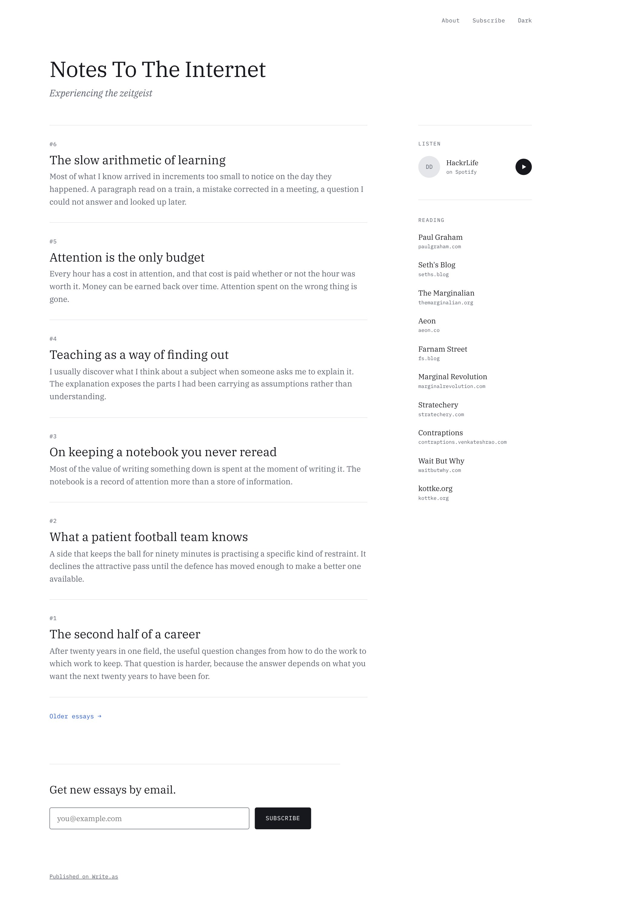

# Write.as Templates

A gallery of free, open-source themes for [Write.as](https://write.as) blogs, by [Dev Das](https://blog.dev-das.com).

Each template is a folder with its own CSS, JavaScript, screenshots and setup guide. Pick one, download it, paste two files into your blog's settings, and edit the settings block at the top to make it yours.

## The gallery

| | Template | Made for | Highlights |
|---|---|---|---|
| [](templates/essayist) | **[Essayist](templates/essayist)** | Essay and long-form blogs | Typographic layout, numbered essays instead of dates, right-hand reading list and podcast card, share links, subscribe box, About photo, dark mode, mobile ready |

More templates are on the way. Watch or star this repository to hear when a new one lands.

## How to use a template

1. **Open the template's folder** in the gallery above and read its guide.
2. **Download it.** Each folder has a `.zip` with everything you need, linked at the top of its guide.
3. **Open Write.as → Blogs → your blog → Customize.**
4. **Paste the CSS** into **Custom CSS** and the **JavaScript** into **Custom JavaScript**.
5. **Edit the settings** at the top of each file (your blog's alias, links, colours, wording), then **Save changes**.

Full steps, with fixes for common problems, are in [INSTALL.md](INSTALL.md).

### What you need

- **Write.as Pro.** Custom CSS and JavaScript are Pro features.
- **Your blog on its own address** (`yourblog.writeas.com` or a custom domain) for templates that use JavaScript. Write.as doesn't run custom JavaScript on `write.as/yourblog`.

## What's in this repository

```
writeas-templates/
├── README.md          This gallery
├── INSTALL.md         How to install any template
├── LICENSE            MIT
├── templates/
│   └── essayist/      One folder per template
│       ├── README.md          Guide and settings
│       ├── essayist.css       Paste into Custom CSS
│       ├── essayist.js        Paste into Custom JavaScript
│       ├── about-template.md  Starting layout for an About page
│       ├── essayist.zip       Everything above in one download
│       └── screenshots/
└── starter/           Blank template to build a new one from
```

## Requests and feedback

Want a template for a particular kind of blog, or found something that doesn't work? [Open an issue](https://github.com/HackrLife/writeas-templates/issues/new/choose).

Using one of these templates on your blog? Open an issue with the link and it may be featured here.

## Licence

MIT. Use the templates, change them and share them. A link back is appreciated.
