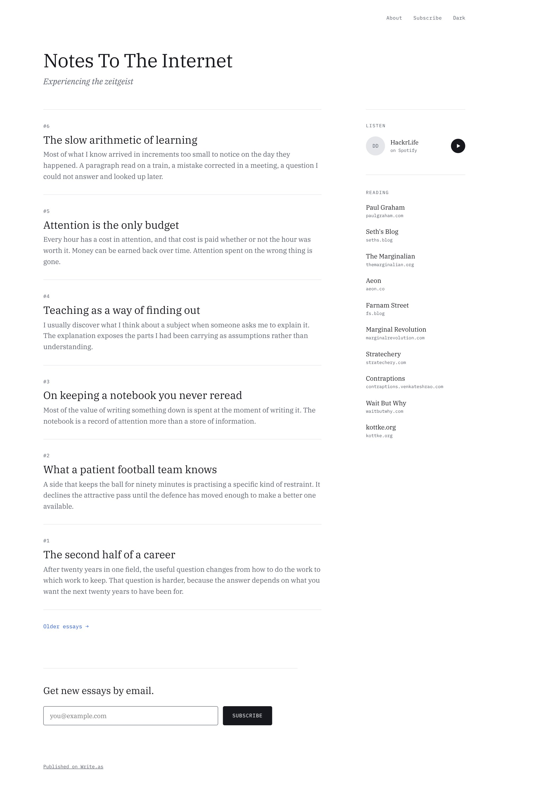
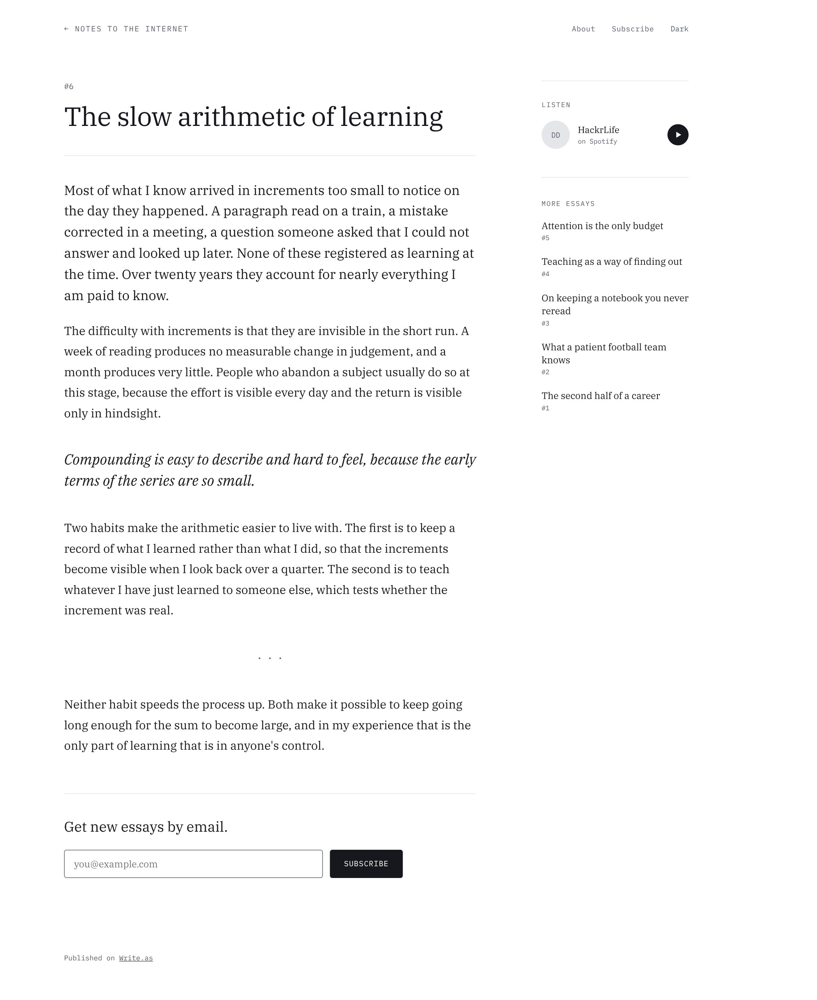
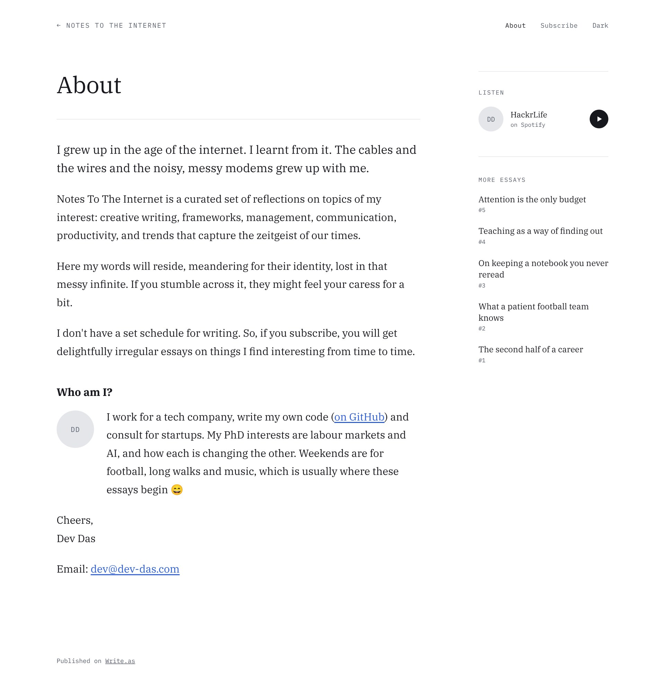
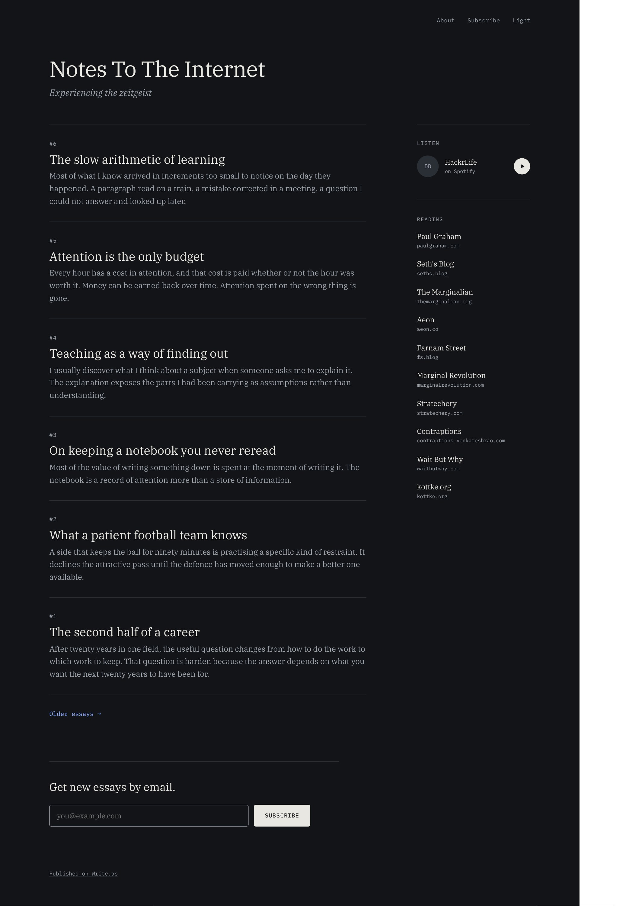
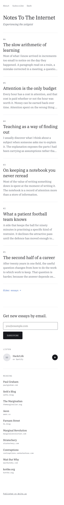

# Essayist

A typographic theme for [Write.as](https://write.as), made for essay blogs. Reading comes first: one serif column, no featured images and no dates.

Built for [Notes To The Internet](https://blog.dev-das.com) by Dev Das.

**[Download essayist.zip](https://github.com/HackrLife/writeas-templates/raw/main/templates/essayist/essayist.zip)** (CSS, JavaScript, About page template and this guide)

## What it does

- **A typographic home page.** The blog title, a one-line strap, then each essay as a title and a four-line summary. No images or cards.
- **Numbers instead of dates.** Essays show `#1`, `#2` … counted from your first, so a gap between posts never shows.
- **A right-hand column.** A podcast card on every page, a reading list of other writers on the home page, and your own other essays on each essay page. The essay list builds itself.
- **Share links.** X, LinkedIn, WhatsApp, Email and Copy link under every essay; on phones, a **More** button opens the phone's own share menu.
- **Subscribe everywhere.** One line and an email field at the end of each essay, connected to Write.as's own newsletter.
- **About page with your photo.** A small round photo beside your "Who am I?" paragraph.
- **Light by default, with a Dark switch.** The reader's choice is remembered.
- **Built for phones.** On narrow screens everything stacks into one column.

| Essay page | About page | Dark mode | Phone |
|---|---|---|---|
|  |  |  |  |

## Requirements

- **Write.as Pro.** Custom CSS and JavaScript are Pro features.
- **Your blog on its own address**, either `yourblog.writeas.com` or a custom domain. Write.as runs custom JavaScript only there. On `write.as/yourblog` the CSS still works, but the numbers, right-hand column, subscribe box and Dark switch don't appear.

## Install

1. Open **Write.as → Blogs → your blog → Customize**.
2. Under **Preferred URL**, choose your `.writeas.com` address or a custom domain.
3. Paste all of `essayist.css` into **Custom CSS**.
4. Paste all of `essayist.js` into **Custom JavaScript**.
5. Edit the settings block at the top of the JavaScript (below), then **Save changes**.

## Settings

Everything is editable. Settings sit at the top of each file, so nothing below them needs touching.

**In `essayist.js`**

| Setting | What to put there |
|---|---|
| `BLOG_ALIAS` | Your blog's short name, the part after `write.as/` in its address. Needed for numbering and the essay list. |
| `ME.photo`, `ME.name` | A link to a square photo of you, and your name. With no photo, your initials show. |
| `PODCAST.spotify` | Your show's Spotify link (Share → Copy link to show). Leave `''` to hide the podcast card. |
| `PODCAST.title` | Optional name for the card. Leave `''` to use the show's name from Spotify. |
| `READING` | Ten placeholder lines, `['Blog 1', 'https://example.com']`. Replace each name and address with blogs you read; add or remove lines. |
| `SHARE` | The share links under each essay: `'x'`, `'linkedin'`, `'whatsapp'`, `'email'`, `'copy'`. Remove any you don't want; they show in this order. |
| `OPTIONS` | Switch essay numbers on or off, set how many of your other essays to list (0 hides the list), hide the Dark switch, and set your About page's address. |
| `TEXT` | Every word the theme shows: menu labels, subscribe line, button, section headings and the number prefix. Rewrite them in your own voice or language. |
| `FORM_ACTION` | Leave as is to use Write.as's newsletter. To use another email provider, paste its form address here. |

**In `essayist.css`**, the first block sets colours (light and dark), fonts, and widths: `--measure` (an essay), `--index` (the home page list), `--aside` (the right-hand column) and `--gap` (the space between columns).

## About page

1. Publish a post titled **About** on your blog.
2. Give it a section headed `### Who am I?`. Your photo appears beside the paragraph that follows.
3. **Pin** the post. In the blog's post list, choose **pin** next to it. This removes it from the essay list and adds **About** to the top menu.

`about-template.md` has a starting layout.

## Tips

- Write.as builds each summary from the start of the essay, so make the first paragraph a good one.
- Once an essay is published, don't delete it. Numbers are counted from the first essay, so deleting one renumbers every essay after it.
- Separate sections of an essay with a `---` line; it shows as three spaced dots.
- Start a line with `>` for a pull quote; it shows in large italics.

## Licence

MIT. Use it, change it and share it. A link back is appreciated.

[← All templates](../../README.md)
